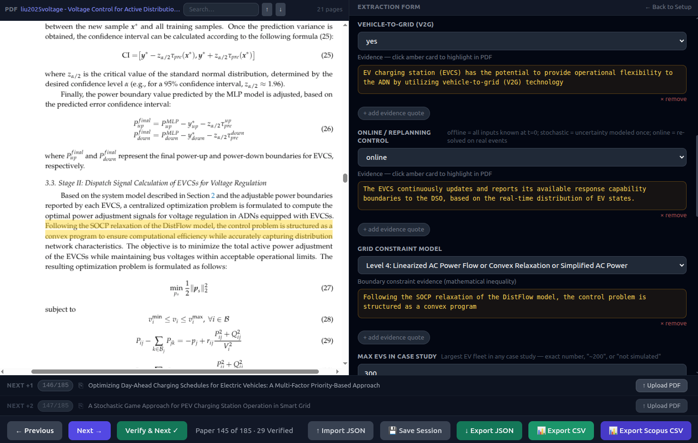

# EV Review Tool

Browser-based tools used for the screening and data-extraction stages of a systematic literature review on electric vehicle (EV) smart charging and power grid integration.

The repository is the companion to the review paper (citation will be added on publication). It is provided so that the screening and extraction workflow can be inspected and reproduced. It is not (yet) a general-purpose review tool.

## Contents

| Path | Purpose |
| --- | --- |
| [`abstract-scanning.html`](abstract-scanning.html) | Title/abstract screening console. Load a Scopus CSV export, step through the records and record an `Exclusion Reason` and `Note` per paper, then export the CSV again. Works fully offline apart from CDN libraries; no AI involved. |
| [`paper-analyzer/`](paper-analyzer/) | Full-text data-extraction assistant. Load PDFs (and optionally the screening CSV), send the extracted text to a Google Gemini model with a structured prompt, and review/correct every extracted field together with its verbatim evidence quotes before exporting. |
| [`paper-analyzer/fields.json`](paper-analyzer/fields.json) | The extraction schema used in the review: each field, its allowed values and the instructions given to the model. |
| [`paper-analyzer/prompt.txt`](paper-analyzer/prompt.txt) | The prompt template the field definitions are inserted into. |

`fields.json` and `prompt.txt` are the exact extraction instructions used for the review. The extraction app is designed so that a human reviewer checks every AI-extracted value against its quoted evidence.

## Screenshot



The extraction assistant (`paper-analyzer`), with the extraction form and its evidence quotes (right) next to the source PDF (left). The values shown are the model's suggestions before human verification. The PDF shown is C. Liu, K. Xu, W. Xu, F. Shao, X. He and Z. Tang, "Voltage Control for Active Distribution Networks Considering Coordination of EV Charging Stations," *Electronics*, 2025, [doi:10.3390/electronics14183591](https://doi.org/10.3390/electronics14183591), reproduced under a [CC BY 4.0](https://creativecommons.org/licenses/by/4.0/) license.

## Running

Both tools are static HTML/JavaScript; there is no build step and no backend.

**Screening:** open `abstract-scanning.html` in a browser.

**Extraction:** serve the `paper-analyzer` folder over HTTP so it can load `fields.json` and `prompt.txt`:

```bash
cd paper-analyzer
python3 -m http.server 8000
# open http://localhost:8000
```

(Opening `index.html` directly from disk also works, but then the built-in default fields are used instead of `fields.json`.)

You need your own Gemini API key from [Google AI Studio](https://aistudio.google.com/app/apikey). Enter it in the app; it is stored only in your browser's `localStorage` and is sent only to the Gemini API. The model can be chosen in the UI. Choosing "No model" lets you import JSON results manually.

## Data and privacy

- PDFs and CSV files are processed locally in the browser. Only the extracted paper text is sent to the selected Gemini model.
- This repository contains no papers, Scopus exports or review data.
- Third-party libraries (Tailwind CSS, PapaParse, PDF.js, KaTeX) are loaded from public CDNs.

## Citation

If you use or refer to this tool, please cite it using the metadata in [`CITATION.cff`](CITATION.cff) (GitHub's "Cite this repository" button) and the associated review paper.

## AI assistance

The code in this repository was written with the assistance of Claude Code (Anthropic). All code was reviewed and tested by the author.

## License

[MIT](LICENSE)
